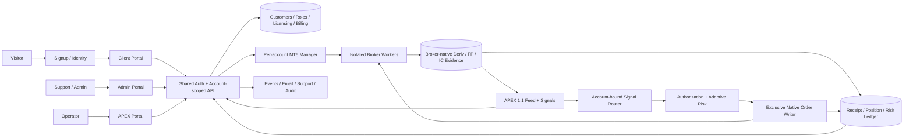
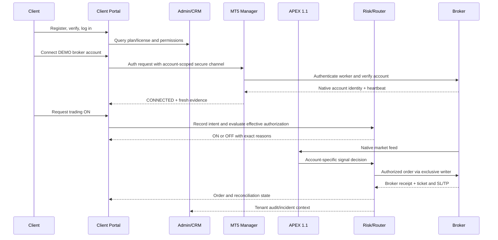

# ABUTRON APEX | Master Three-Portal Architecture Blueprint
**Document ID:** ABU-PORTALS-MASTER-20261113  
**Version:** 1.0 | **Prepared:** 2026-11-13 (Africa/Johannesburg)  
**Classification:** Internal engineering and product architecture; *not* a claim of production certification.  
**Scope:** Client Portal `/account/client/`, Admin Portal `/account/admin/`, APEX Operator Portal `/apex/`.

## 1. Purpose and system boundary
Create a single, coherent ABUTRON platform in which the **Client Portal** owns the customer-facing journey, the **Admin Portal** owns commercial/identity/entitlement management, and the **APEX Portal** owns operational visibility and authorized execution control. The three portals share canonical identity, accounts, licensing, risk state, signal/decision provenance, broker evidence, and audit infrastructure. A page displaying a value must *not* become an independent source of truth for that value.

**Control-plane rule:** client wishes to enable trading (`requested_enabled`) are not synonymous with runtime permission (`effective_enabled`). Effective state is computed from account ownership, broker session, license, risk, execution-path health, and validated broker evidence. The Client Portal can express intent. Admin can change entitlements within scope. APEX observes/operates the execution infrastructure. The broker remains authoritative for orders, deals, positions, prices, and stop updates.

**Branding:** ABUTRON in customer-facing pages. APEX 1.1 remains the engine/operator name. Legacy Kronos, Hermes, Qwen/TradingAgents/SMC/ICT veto layers must not be added to the *proposed production execution path*. Historic code/data may remain for migration and audit until reviewed; deleting components is a separate change request.

## 2. Integrated architecture




### 2.1 Layers and authoritative data
| Layer | Authority and responsibilities | Access boundary |
|---|---|---|
| Identity | Sign-up, email verification, login, sessions, MFA, roles | Tenant-scoped; admin MFA; secure cookies |
| Commercial | Plan, subscription, license, seat count, invoice/payment status | Admin writes, client reads/requests; provider webhooks validated |
| Broker connections | Enrollment, native authentication, connectivity state, account ownership | Isolated manager/workers; no exposed broker passwords |
| Risk and authorization | Desired ON/OFF, effective ON/OFF, account risk parameters, owner-wide exposure | Account-scoped; independent broker evidence; 20% owner portfolio ceiling |
| APEX research | Instrument feed, M5/M15/H1 features, signals, HOLD reasons, confidence | Read-only publisher; no order authority |
| Execution | Exclusive account-bound dispatcher, native EA bridge, broker receipts | Server-only operations; idempotent, broker-confirmed |
| Position ledger | Broker orders, deals, positions, SL/TP, costs, cashflows, reconciliation | Broker-native evidence wins over portal projections |
| Observability | Services, timers, heartbeats, source hashes, outages, blockers | Operator read; audited limited actions |
| Notifications | Email/in-app messages, support, billing lifecycle | User preferences, explicit delivery state |

### 2.2 Distinguish seven separate statuses
1. **Account enrolled**: broker login reference stored; no proof of authentication.
2. **Broker authenticated**: worker has proven broker account identity/session.
3. **Data fresh**: native prices/history/position exports are current; timestamped.
4. **Client requested ON**: customer intent recorded, not trade authorization.
5. **Effectively ON**: all owner/account/risk/bridge checks currently allow *new* trades.
6. **Order submitted / broker acknowledged**: separate evidence states, never conflated.
7. **Position protected and reconciled**: native position + SL/TP + risk + lifecycle reconciled.

### 2.3 High-level lifecycle


## 3. Governance and role matrix
**Principal types:** Visitor, Customer, Support, Billing Admin, License Admin, Superadmin, Operator (read), Operator (execute), Background service. Roles are *proposed granular target roles* except existing Superadmin; implement only after permission design and testing.

| Capability | Client | Support | Billing Admin | License Admin | Superadmin | APEX Operator |
|---|---|---|---|---|---|---|
| View own portfolio | Own only | Redacted as assigned | No | No | Audited | Assigned operational scope |
| Add/remove own broker links | Own only | Assist by request | No | No | With audit | Diagnose only |
| Set own requested trading ON/OFF | Own only | No | No | No | No silent override | No silent override |
| Change license/seat | Request | No | Invoice only | Yes | Yes | Read only |
| Grant roles | No | No | No | No | Yes + MFA + audit | No |
| Review all-customer health | No | Scoped | No | Scoped | Yes | Yes, redacted |
| Dispatch broker orders | No direct access | No | No | No | No by portal default | Via approved backend authority only |
| View broker secrets | Never | Never | Never | Never | Never | Never |
| Disable new entries on incident | Own account OFF | Escalate | No | License effect only | Audited global incident | Audited emergency control |
| Amend/close an existing broker position | Broker/MT5-specific client rights | No | No | No | No by default | Only explicitly authorized repair workflow |

**SoD (segregation of duties):** Admin license approval does not by itself enable live execution; an operator cannot grant customer billing entitlement; a client cannot alter other tenants. Any highly privileged action requires identity re-verification, purpose, audit ID, and rollback/compensating action.

## 4. Canonical entities (logical data contract; physical schemas require migration review)
```text
Customer(customer_id, email, name, country, status, verified_at)
Session(session_id, customer_id, role, issued_at, expires_at, revoked_at)
RoleGrant(grant_id, actor_id, subject_id, role, scope, granted_at, revoked_at)
Subscription(subscription_id, customer_id, plan_id, state, renewal_at)
License(license_id, customer_id, plan, seats, status, valid_from, valid_to)
Invoice(invoice_id, subscription_id, amount, currency, provider_ref, state)
BrokerConnection(connection_id, customer_id, broker, environment, server, account_ref,
                 status, heartbeat_at, native_identity_hash, worker_id)
TradingControl(connection_id, requested_enabled, effective_enabled, reasons, revision, updated_at)
RiskPolicy(customer_id, account_id, per_trade_pct, owner_portfolio_pct, currency, revision)
MarketBar(feed_id, broker, symbol, timeframe, close_time, observed_at, quality)
Decision(decision_id, account_id, strategy_version, symbol, side, confidence,
         bar_close_time, features_hash, reasons, created_at)
ExecutionIntent(intent_id, decision_id, account_id, idempotency_key, policy_snapshot, status)
BrokerReceipt(receipt_id, intent_id, native_ticket, order_status, broker_time, evidence_hash)
Position(position_id, connection_id, broker_ticket, side, lots, entry, sl, tp, updated_at)
Reconciliation(run_id, connection_id, evidence_source, native_positions, pending_receipts,
               unknown_count, stop_risk, freshness, result, checked_at)
AuditEvent(event_id, actor, tenant, action, object_type, object_id, before, after,
           outcome, correlation_id, created_at)
Notification(id, recipient, channel, event_kind, state, sent_at)
SupportCase(id, customer_id, severity, state, owner, created_at)
```
- IDs are immutable and never replaced by user-facing 4-digit MT5 suffixes. Display suffixes only; account binding uses strong internal IDs and broker-native IDs.
- Every event has `occurred_at`, `observed_at`, `source`, `schema_version`, `account_id`, `correlation_id`, and `evidence_quality` where relevant.
- Use migrations for existing SQLite; do **not** presume the illustrative schema above already exists.
- Database ownership, encryption at rest, durability, retention, and source-controlled migrations must be specified before implementation. No credentials, secret keys, or client identity dumps in a public repository.

## 5. Shared API contract conventions
`/account/api/client/*` is an **observed current** route family. Other routes below are **proposed versioned contracts** unless an appendix marks them existing. Avoid inventing a deployed endpoint.

- JSON over HTTPS; authentication via secure HttpOnly session cookie; same-origin/CSRF policy for mutation.
- Versioned response envelope: `schema`, `data`, `timestamp_utc`, `freshness_seconds`, `source`, `request_id`, `warnings`.
- Explicit response classes: 400 validation, 401 unauthenticated, 403 unauthorized, 404 out of scope/not found, 409 revision/duplicate conflict, 422 business-rule failure, 429 rate limit, 503 downstream unknown/stale.
- Mutating requests require a tenant-scope check, expected revision, audit record, and idempotency key if retriable.
- External MT5 account state must never be extrapolated from a successful HTTP response; verify native identity and account-specific freshness.
- For all data readouts, show **LIVE DATA**, **DELAYED**, **STALE**, **UNVERIFIED**, or **NO DATA**, with age and provenance.

## 6. Shared states and UX rules
**Account:** `NOT_LINKED -> CONNECTING -> AUTHENTICATING -> CONNECTED -> DEGRADED -> DISCONNECTED`; `ERROR` and `REVOKED` are terminal/repair branches. `CONNECTING` is not `CONNECTED`.

**Trading:** `REQUESTED_OFF`, `REQUESTED_ON_EFFECTIVE_OFF`, `ON_EFFECTIVE`, `PAUSED_BY_CLIENT`, `PAUSED_BY_RISK`, `UNKNOWN_EVIDENCE`; preserve closure and protection of existing positions when disabling new entries.

**Order:** `CANDIDATE -> ELIGIBLE -> AUTHORIZED -> DISPATCH_PENDING -> SENT -> BROKER_ACK -> OPEN_PROTECTED -> MANAGING -> CLOSED -> RECONCILED`; branches `HOLD`, `REJECTED`, `EXPIRED`, `RETRY_SAFELY`, `UNKNOWN_RECEIPT`, `UNPROTECTED_INCIDENT`. A lost receipt requires reconciliation, *not* blind resubmission.

**UI states for each widget:** loading, success, partial, empty, stale, permission denied, request failed, and retry guidance. Errors must include a human-readable reason and internal correlation ID, not broker passwords or raw stack traces.

## 7. Non-negotiable risk/execution invariants
- Use the user's owner-wide **20% portfolio ceiling**. Historical requested per-trade baseline ranged 0.10%, 0.15%, 0.20%; **do not assume which is currently deployed**. Display effective broker-verified account-specific value and revision.
- Adaptive position sizing based on equity, instrument contract specification, spread, stop distance, account currency, and configured risk. Never enlarge a trade just to meet broker minimum size when that breaches risk.
- Per-client and per-account requested ON/OFF must work independently; aggregate owner-wide exposure includes relevant linked accounts, including disconnected/unknown inventory.
- Never place an order for HOLD, stale bars, duplicate decision IDs, missing ownership, unknown exposure, unverified stops, or unverified broker account binding.
- Broker receipts and actual positions trump dispatch intentions; verify SL/TP, stop modification, P&L, fees, swaps, partial fills and lifecycle.
- One native order writer per account. Position protection and closeout continue even after new-entry authorization is disabled.
- DEMO and LIVE are separate; no automatic promotion from DEMO proof to LIVE or undocumented evergreen LIVE ON state.
- User-facing execution alerts must distinguish “requested”, “sent”, “accepted”, “open”, “protected”, “closed” and “reconciled”.

## 8. Cross-portal events
| Event | Owner | Client sees | Admin sees | APEX sees |
|---|---|---|---|---|
| `customer.verified` | Identity | Access unlocked | CRM lifecycle | Count only |
| `license.issued` | Licensing | Entitlement + expiry | Issuer + audit | Entitlement revision |
| `broker.connected` | MT5 manager | Connected/native age | Account health | Worker + broker binding |
| `trading.requested_on` | Client/controls | Requested ON | Audit | Admission reevaluation |
| `trading.effective_off` | Risk/runtime | OFF + exact reason | Exception queue | Failed predicate + evidence |
| `apex.decision_created` | APEX publisher | Approved signals (read only) | Support trace | Full feature/timeframe audit |
| `order.broker_acknowledged` | Broker reconcile | Ticket/position | Incident summary | Receipt + hash |
| `position.stop_changed` | Broker-native | New stop/risk | Case context | Tightening/widening verification |
| `reconcile.failed` | Native reconcile | Stale/unknown banner | Customer impact | Incident response |
| `subscription.expiring` | Billing | Renewal action | Dunning queue | Future entitlement effect |

## 9. Practical route inventory (verified from 2026-11-13 read-only inspection)
**Frontend routes observed:** `/account/client/`, `/account/admin/`, `/apex/` through Caddy routing.  
**Services active in snapshot:** `apex-client-portal.service`, `apex-signup.service`; APEX operator local GET `/api/apex11-engines` returned HTTP 200.  
**Client backend observed:** `/opt/apex-client-portal/server.py` includes `GET /account/api/client/me`, `/connections`, `/trading-controls`, `/license/summary`, `/license-permissions`, `/ai-engine`, `/runtime-health`, `/fp-native-history`, `/fp-market`; `POST /login`, `/logout`, `/connections/mt5/connect`, `/license/request`, `/trading-controls/{connection_id}`; `DELETE /connections/{connection_id}`. Legacy enrollment/OTP endpoints return HTTP 410.

**Admin backend observed:** `apex_admin.py` handles `/account/api/client/admin/me`, `/overview`, email MFA challenge and verify, logout, FP native readouts; admin overview declares `READ_ONLY` and does not grant license/role/payment/broker mutation authority.  
**APEX operator observed:** `/opt/apex/runtime/apex_ui/app.py` includes GET endpoints `/api/overview`, `/api/apex11-engines`, `/api/apex11-broker-evidence`, `/api/runtime-health`, `/api/fp-market*`, `/api/fp-native-history`, `/api/scanner`, `/api/risk-governor`, `/api/order-prechecks`, `/api/execution-preview`, `/api/decision-intelligence`, `/api/chart`.

**Snapshot discrepancy:** At 2026-11-13 15:36 UTC, `/api/apex11-engines` returned `fresh_account_publishers=5`, `total_account_publishers=6`, `fp_apex11_engine_link_verified=false`, and `orders_submitted_by_publishers=null`. That is **not** evidence of native order execution. A number of trading/reconciliation systemd units were in failed state at inspection; individually investigate current state before declaring readiness.

## 10. Delivery phases, dependencies and acceptance
| Phase | Result | Verification | Rollback |
|---|---|---|---|
| P0 - Evidence | Read-only inventory, route and schema map, tenant/risk baselines | hashes, endpoint probes, DB schema-only, owner/worker map | None: non-mutating |
| P1 - Shared contract | Identity, roles, canonical state, API envelopes | auth/CSRF/tenant tests, contract snapshots | code deploy revert + schema reversible plan |
| P2 - Client | Full onboarding, connected account status, requested/effective control, positions | staging E2E, owner isolation, stale-state tests | revert frontend/backend independently |
| P3 - Admin | Scoped CRM, license/billing work queues, MFA/audit | role matrix, dual-authorization, webhook replay tests | limited feature flags, restore versioned state |
| P4 - APEX | End-to-end trace signal -> exclusive writer -> native broker -> reconciliation | DEMO broker tickets, broker SL/TP, no unknown receipts, restart tests | disable *new entries* per account; preserve exits |
| P5 - Release | V7 parity, reliability, cross-portal consistency | synthetic tests, accessibility, monitoring, backup restore | reversible release with verified restore |

**No deployment claim:** This is an implementable target blueprint and gap map, not evidence that all features already operate. Existing source/service facts above were read-only checked; live order state and trade certification were not independently proven by this blueprint exercise.

## 11. Linked detailed specifications
- `01_CLIENT_FLOW_BLUEPRINT.md` — all customer-facing pages, actions, state, error paths, APIs and acceptance tests.
- `02_ADMIN_FLOW_BLUEPRINT.md` — CRM, roles, licensing, subscriptions, support, compliance and audit.
- `03_APEX_FLOW_BLUEPRINT.md` — signal, account router, exclusive writer, broker-native receipts, risk, observability, operations.

## 12. Open design decisions for implementation
1. Should Admin remain commercial/read-only relative to broker execution (recommended), with all order-capable maintenance confined to auditable APEX operations?
2. Should a customer be permitted to request LIVE ON after separate verified onboarding, or is LIVE never provisioned in the initial release?
3. Final authoritative per-trade risk percentage and account-specific overrides must be read from live policy, not copied from conversation history.
4. Which licensing plans and payment rails are commercially approved? Do not label pending payment gateways as operational.
5. Is the future Prop Firm/AB Markets portfolio a separate product database or an integrated tenant/subscription, subject to its own operational and regulatory readiness?