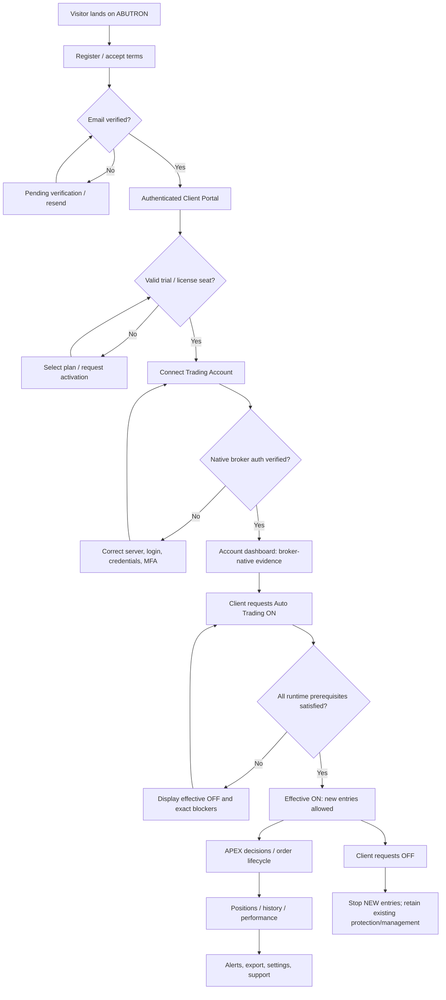

# ABUTRON | CLIENT-FLOW: Client Portal Blueprint
**Document ID:** ABU-CLIENT-FLOW-20261113  
**Version:** 1.0 | **Design type:** Detailed UX + backend workflow + acceptance specification  
**Primary route:** `/account/client/` | **Brand:** ABUTRON  
**Evidence labels:** `OBSERVED` = inspected production code/service; `HISTORICAL` = prior project checkpoint; `TARGET` = implementation specification, not production verification.

## 1. Customer mission
A customer must be able to create an account, confirm identity, choose a plan, connect one or more MT5 accounts, understand whether each account is truly connected, request automatic trading ON/OFF independently, inspect authentic broker positions and performance, trace APEX 1.1 signals to resulting broker tickets, receive incidents, manage payment/license and request support. No page may suggest a real broker trade occurred without native broker evidence.

### 1.1 Actors and permissions
- Visitor: public pricing, registration, legal notices, login and password reset only.
- Pending customer: email verification, profile, support; account linking blocked until verification.
- Active customer: own account list, broker link/disconnect, own requested ON/OFF, own telemetry and trade history, own licensing requests.
- Suspended/expired customer: view historical data/export, resolve billing/support; no new entries; do not impair protections/exits for open positions.
- Customer with multi-account tenancy: separate account selectors and isolation per linked broker account, plus explicit owner-wide exposure aggregation.

### 1.2 Route and screen map
```text
/account/client/
  /welcome                     (TARGET optional first-use experience)
  /dashboard                   (TARGET logical view)
  /trading-accounts            (TARGET logical view)
    /connect                   (TARGET view)
    /:connection_id            (TARGET account detail)
  /trading-controls            (TARGET logical view)
  /markets-and-signals         (TARGET logical view)
  /positions                   (TARGET logical view)
  /trade-history               (TARGET logical view)
  /performance                 (TARGET logical view)
  /subscription                (TARGET logical view)
  /prop-firm                   (TARGET logical view, depends on availability)
  /notifications               (TARGET logical view)
  /support                     (TARGET logical view)
  /profile-and-security        (TARGET logical view)
```
**Important:** Child paths above are proposed information architecture, not claims that separate deployed URLs exist. V7 client frontend is currently at `/var/www/abutron-v7/client/index.html` and current customer JS includes Dashboard, Trading Accounts, Subscriptions, Notifications and Prop Firm labels.

## 2. End-to-end flow map




## 3. First-use and identity flow
**C01 - Registration.** Customer opens ABUTRON site -> chooses Register -> enters name, email, country, password, accepts current Terms/Privacy and optional marketing separately -> submission creates pending customer with unique customer ID and timestamp; rate-limit and deduplicate; send verification email. Never silently enable broker trading during signup.

**C02 - Email verification.** Link token bound to intended customer, expires after configured duration, single use. Success sets verified timestamp and status; error states `EXPIRED`, `ALREADY_USED`, `INVALID`, `DELIVERY_FAILED`; resend throttled. Existing client API gates broker connection actions on `approved` customer status.

**C03 - Login.** Customer enters credentials -> server validates -> secure HttpOnly/SameSite session cookie -> dashboard loaded from authenticated `/me`; make account data unavailable to unauthenticated sessions. Current backend logs access attempts with hashing/rate guard; do not expose reason distinguishing invalid usernames.

**C04 - Recovery/security.** Password reset, change password, revoke sessions, logout, verify email-change request and optionally MFA for customer account. Sensitive changes invalidate prior sessions after explicit policy. Avoid combining broker account credentials with ABUTRON login credentials.

**C05 - First-use checklist.** Six meaningful steps: verify email -> review trial/plan -> connect broker -> verify native identity -> review adaptive risk -> request trading ON. A step is complete only if server-side evidence attests completion; no decorative fake checkmarks.

## 4. Dashboard: widgets and definitions
| Widget | User-facing fields | Truth/source and empty state |
|---|---|---|
| Account portfolio | broker, account suffix, DEMO/LIVE, native connected state, last update | MT5 manager + broker identity; show `Not verified` if no heartbeat |
| Balances | balance, equity, free margin, used margin, account currency | native broker snapshot with age; never derived from invoices |
| Open exposure | positions, native stop-risk USD, account/owner risk %, unresolved exposure | native account positions and reconciled risk inventory |
| Trading switches | requested, effective, reason, revision, updated at | authoritative trading controls; OFF due risk distinct from user OFF |
| APEX 1.1 | latest decision, side, symbol, timeframe, freshness, HOLD reason | account-bound decisions; publication ≠ execution |
| Trade summary | broker-confirmed fills, closed P&L, fees, swaps, unknown receipts | receipt and history reconciler |
| Subscription | plan, renewal, seats, expiry, status | CRM licensing service |
| Alerts | unsupported broker, stale session, reject, stop risk, license due | event service with timestamps and severity |

**Data reliability:** Portfolio components may refresh at different rates. Each card must display `as of` time and source. If owner-wide exposure is incomplete, show UNKNOWN and do not render a reassuring 0%.

## 5. Trading Accounts flow (highest-priority customer workflow)
**C10 - View linked accounts.** List account alias, broker (Deriv/FP Markets/IC Markets as supported), environment, broker server, masked login, authentication status, MT5 worker state, last native update, requested/effective trading state, active positions and available actions. Sort accounts by user preference and show disconnected accounts as such.

**C11 - Add Trading Account.** Click `Connect Trading Account` -> select broker -> DEMO or LIVE -> broker-defined MT5 server -> account login/reference -> supply broker authentication through secure backend-only path -> confirm authorization to access account -> backend creates scoped connection request -> dedicated manager connects/authenticates -> broker-native account identity checked against request -> fetch account specs/equity/position inventory -> return CONNECTED or exact error.

**C12 - Connection statuses.** `NOT_LINKED`, `CONNECTING`, `AUTHENTICATING`, `CONNECTED`, `DEGRADED`, `DISCONNECTED`, `REVOKED`, `ERROR`. Never say CONNECTED merely because login record exists. Surface `BROKER_SERVER_MISMATCH`, `CREDENTIAL_INVALID`, `SESSION_EXPIRED`, `BROKER_UNAVAILABLE`, `WORKER_EXITED`, `NATIVE_DATA_STALE`, `DUPLICATE_ACCOUNT_OWNER` distinctly.

**C13 - Native MT5 controls.** On account detail: test connection (read-only), view last authenticated broker heartbeat, refresh history safely, edit display alias, disconnect/relink, per-account requested ON/OFF, position management handoff to broker terminal (only if implemented). Never print raw broker password or internal private socket URL to browser.

**C14 - Disconnect.** Confirmation screen shows any open positions, pending broker orders, and what happens to automation/monitoring. Revoke new-entry entitlement first, ensure existing position protection/exits have an owner, then disconnect broker worker and mark status. If native open positions remain, show explicit unresolved operations; don't claim exposure vanished.

**C15 - Account isolation.** Every query/mutation scoped by authenticated customer ID and connection ID. One customer cannot guess another connection ID and view positions, modify risk, or disconnect it. All account ownership is validated server-side.

**C16 - Multi-account.** Deriv DEMO 6207/7593/9244 and FP DEMO 0512/1636/1622 and other recovered accounts may appear depending on actual owner/connection evidence. These suffixes are *historical project inventory*, not a directive to show every account to every client. Aggregate only accounts truly owned by logged-in customer. Each account has independent risk settings, strategy/worker, bridge and broker receipt stream.

## 6. Per-account Automatic Trading controls
**C20 - Requested toggle.** Customer selects broker account -> sees effective risk policy and coverage -> selects `Request ON` or `Turn OFF`. Display requested and effective state separately; client cannot directly call broker order writer.

**C21 - ON evaluation.** Save `requested_enabled=true` and revision atomically, then calculate `effective_enabled` from customer/seat/license entitlement, broker authentication, account type, live/demo permission, fresh feed, worker/EA bridge binding, risk policy, owner-wide risk inventory, exclusive writer identity, SL/TP capabilities and broker reconciliation freshness.

**C22 - Blocked ON.** UI response includes top reason and secondary reasons with action links: renew license; verify email; reconnect MT5; resolve EA initialization; wait for data; investigate owner risk; contact support. A request may be saved without effective ON if policy permits. Do not misrepresent a local HTTP success as trade enablement.

**C23 - OFF semantics.** Client OFF immediately prevents *new* order intents for the selected account; cancel pending locally unsubmitted intents; continue reconciling, monitoring, and protective SL/TP/close lifecycle for existing broker positions. Confirm effective OFF from control service and display pending state if runtime ACK not yet obtained.

**C24 - Risk editing.** Show configured percentage per trade and owner-level ceiling. The project owner has explicitly required a 20% overall ceiling and historically requested 0.10%, 0.15%, and 0.20% per trade. Do not assume 0.20% is currently active. Any allowed change uses validation, revision, previewed dollar risk, and audit; if editing is unavailable, show read-only effective policy without a fake control.

**C25 - DEMO/LIVE.** DEMO control cannot enable LIVE. LIVE is a separate broker connection, permission, capital and billing risk workflow. Distinct labels/icons, warnings, and audit trail on any LIVE action. No hidden conversion from demo to live.

## 7. Markets & APEX Signals
**C30 - Instrument registry.** Show broker-specific symbols exactly as native broker exposes them (e.g. Deriv volatility variants, FP `.r` suffixes), selected timeframes M5/M15/H1, spread/costs, freshness, and supported status. Never normalize away a broker symbol suffix in the order ticket.

**C31 - Decision cards.** For each account and closed bar, show `BUY`, `SELL` or `HOLD`; strategy version; symbol; generated and bar-close UTC; confidence/score if genuine; timeframes and disagreement; the specific reasons for HOLD/rejection; source-feed age; unique decision ID.

**C32 - Signal-to-execution trace.** Drill-down must join `decision_id -> policy/admission decision -> order intent -> broker order/deal ticket -> protected position -> final result`. If no order, label `RESEARCH ONLY`, `BLOCKED`, `EXPIRED` or `NOT SUBMITTED`, not `TRADED`.

**C33 - Signal quality.** Show directional accuracy, time in trade, realized expectancy, costs and slippage only after an adequate, correctly joined sample exists. No fabricated win rate or unverified simulated P&L.

## 8. Positions, trade history, and account analytics
**C40 - Active positions.** Native ticket, symbol, side, entry, lot, current price, unrealized P&L, SL, TP, current USD stop-risk, last broker update, ownership and protection status. Use `UNKNOWN` for missing or stale SL/TP evidence. Risk uses actual broker contract data, not assumed pip values.

**C41 - Closed trades.** Native order/deal identifiers, opening/closing timestamps, realized gross/net P&L, commissions, swap, broker fees, strategy decision correlation, reason for close, reconciliation status. Distinguish broker-native history from local journal estimates.

**C42 - Equity/performance.** Timeline with native account currency, realized vs unrealized P&L, deposits/withdrawals separated from trading result, drawdown, expected vs actual transaction costs, exposure and monthly summaries. Missing past broker history must show coverage gap; do not infer trading alpha from cashflows.

**C43 - User actions.** Export CSV of *own* trades with scope/time range, refresh validated evidence, open ticket detail, filter by account/environment/strategy, and submit support case for discrepancies. Export excludes broker credentials and other tenants.

## 9. Subscription, licensing and billing
**C50 - Current plan.** Show trial/Starter/Professional/Enterprise plans as applicable to actual catalog, seat usage, licensed account count, permitted products, expiry and entitlement status. Historical intended tiers are not proof of current catalog/prices.

**C51 - Request upgrade.** Select plan/seat count -> show actual provider checkout or manual approval depending on commercial readiness -> create license request -> show `REQUESTED`, `AWAITING_PAYMENT`, `UNDER_REVIEW`, `ACTIVE`, `REJECTED`, `EXPIRED` or `CANCELLED` as warranted by authoritative CRM.

**C52 - Payment.** Do not display `Payment successful` until signed provider confirmation and reconciled invoice state. If provider integration is not live, explicitly show manual/pending payment flow. Cards and provider tokens never stored in portal database.

**C53 - Renewal and downgrade.** Show policy before action; reduce new-entry permissions only as defined, preserve historical read access and protective exit handling; admin/license role may resolve exceptions. Notify ahead of expiration without pretending payments are verified.

## 10. Prop Firm and AB Markets surfaces
**C60 - Prop Firm.** An optional product area for challenge selection, evaluation rules, stage status, account assignment, objectives, breach calculations, billing, payouts and support. Every score/rule source must be explicit; if program not launched, label `Coming soon` or `Not active` and avoid implying funded accounts/payouts.

**C61 - AB Markets.** Distinct future brokerage initiative, not interchangeable with existing Deriv/FP/IC broker connections. Separate legal, compliance, client money and trading readiness required before showing it as an active broker.

## 11. Notifications, support and profile
**C70 - Notifications.** Categories: signup/email, broker disconnect, account trading effective state changed, order accepted/rejected, unknown receipt, missing protection, high risk, subscription due, support reply. Mark read/unread and delivery timestamp. Do not send order acceptance before native broker ACK.

**C71 - Support.** Create case with account ID (masked), category, severity, description, attachments with privacy scanning, auto-correlation IDs and lifecycle `OPEN -> INVESTIGATING -> WAITING_CUSTOMER -> RESOLVED -> CLOSED`. Support cannot view broker passwords or directly execute trades.

**C72 - Profile and security.** Update display name, preferences, time zone (default local SAST display and UTC technical timestamps), notification settings, sign out all sessions; sensitive identity changes require re-verification. Display privacy and data-export controls according to actual regulatory policy.

## 12. Customer-facing API map
### 12.1 OBSERVED backend endpoints (checked 2026-11-13)
| Method | Path | Intended capability | Caveat |
|---|---|---|---|
| GET | `/account/api/client/me` | current identity/license summary | Existing code response hardcodes execution false |
| POST | `/account/api/client/login`, `/logout` | login/session lifecycle | Same-origin validation |
| GET | `/account/api/client/connections` | own connection list | Enrollment ≠ native CONNECTED |
| GET | `/account/api/client/connections/{id}/status` | native connection status | Must check owner |
| POST | `/account/api/client/connections/mt5/connect` | broker native connect | DEMO-linked manager scope observed historically |
| DELETE | `/account/api/client/connections/{id}` | disconnect | Must reconcile open exposure |
| GET/POST | `/account/api/client/trading-controls[/{id}]` | requested/effective state | Enable may currently be refused by policy |
| GET | `/account/api/client/runtime-health` | scoped market/runtime summary | API declares read-only and no execution authority |
| GET | `/account/api/client/ai-engine` | operator research-derived engine status | Not proof of broker execution |
| GET | `/account/api/client/fp-native-history`, `/fp-market` | owned FP data | Freshness and coverage matter |
| GET | `/account/api/client/license/summary`, `/license-permissions` | license and rights | Payment provider not verified active in current endpoint |
| POST | `/account/api/client/license/request` | request license | Request not activation |
| GET/POST | `/account/api/client/requests` | broker-link requests | Historic request intake separate from genuine connection |

### 12.2 TARGET endpoints requiring implementation and versioning
```text
GET  /api/v1/client/portfolio
GET  /api/v1/client/positions?connection_id=...
GET  /api/v1/client/trades?connection_id=...&from=...&to=...
GET  /api/v1/client/signals?connection_id=...&from=...
GET  /api/v1/client/signals/{decision_id}/trace
GET  /api/v1/client/exposure?scope=owner
PUT  /api/v1/client/connections/{id}/trading-intent  (expected_revision; idempotency_key)
GET  /api/v1/client/notifications
POST /api/v1/client/support-cases
GET  /api/v1/client/subscription/invoices
```
These paths are design candidates and must NOT be mistaken for currently available routes.

## 13. UX functional states and acceptance criteria
| ID | Test | Pass criterion |
|---|---|---|
| CLIENT-01 | Registration -> verify -> login | new customer receives unique ID, verified status and scoped session |
| CLIENT-02 | Unverified account attempts to connect | server returns 403; no worker spawned |
| CLIENT-03 | Invalid broker credentials | never shows CONNECTED; no credential leakage |
| CLIENT-04 | Two customer accounts in one browser | no cross-tenant data or mutation under changed IDs |
| CLIENT-05 | Account switch requested ON | requested and effective separately visible, blocker reasons when OFF |
| CLIENT-06 | Turn account OFF during open position | no new entries; existing position protection/exit still tracked |
| CLIENT-07 | Risk calculation | broker specs + current stops; owner ceiling 20%, unknown exposure not silently zero |
| CLIENT-08 | Signal says BUY, order rejected | trace shows rejection, never broker-accepted fill |
| CLIENT-09 | Broker receipt ambiguous | UNKNOWN + reconciliation, no duplicate retry |
| CLIENT-10 | Market feed stale | delayed badge + timestamp, never fresh misleading signal |
| CLIENT-11 | Expired license | new entries disabled; history and protection persist |
| CLIENT-12 | Provider invoice pending | UI does not label payment completed |
| CLIENT-13 | Disconnect with open trades | warnings and retained evidence; no unprotected silent teardown |
| CLIENT-14 | User downloads trade CSV | only own trades, proper timestamps/costs, secrets absent |
| CLIENT-15 | 320px mobile width | navigation, tables, switches and error states remain usable |

## 14. Layout wireframe (proposed)
```text
+-----------------------------------------------------------------------------------+
| ABUTRON | Dashboard | Trading Accounts | Signals | Trades | Subscription | User |
+-----------------------------------------------------------------------------------+
| [Account selector: FP Markets DEMO ···0512]  [CONNECTED • 15s ago] [Data LIVE]      |
| [Balance] [Equity] [Open Risk] [20% Owner Ceiling] [Subscription]                 |
| [Requested: ON]        [Effective: OFF]       [Reason: bridge proof stale]         |
|-----------------------------------------------------------------------------------|
| APEX 1.1 Latest Signals       | Native Open Positions | Recent Broker Receipts     |
| HOLD / BUY / SELL + provenance| Tickets, SL/TP, risk | ACK / unknown / reconciled |
|-----------------------------------------------------------------------------------|
| Notifications / Support           | Broker Health / Last Updated / Coverage       |
+-----------------------------------------------------------------------------------+
```

## 15. Reliability, security and telemetry
- Accessibility: keyboard-operable controls, visible focus, WCAG-conformant contrast, not relying only on colors, localizable number/time/currency formats.
- Session CSRF defense, authenticated scopes, server-side account ownership, rate limits for login and MT5 connection attempts, sensitive-action logs, no passwords in logs/URLs/frontend stores.
- Do not cache protected portfolio across accounts; mark API responses no-store and drop old account state on account switch.
- Client-observed success metrics: signup conversion, verified activation, broker auth rate, mean time to connected, license-to-first-verified-trade, stale UI minutes, support resolution, account state false-positive rate. A “successful trade” metric requires broker evidence.

## 16. Source-to-target gap / execution checklist
| Component | 2026-11-13 evidence | What the blueprint requires |
|---|---|---|
| Portal UI | V7 client frontend exists | Verify every workflow in live browser and mobile |
| Signup/auth | signup and client backend services active | Complete secure recovery/session lifecycle |
| MT5 API | native connect/status/disconnect endpoints observed | Confirm account-specific authentic worker+broker evidence |
| ON/OFF | requested/effective structures observed | Prove effective state, timing, account isolation, and protection behavior |
| Signal status | `/ai-engine` reads APEX operator research summary | Deep link each customer signal to broker ticket and result |
| Trades/performance | FP native-history endpoints exist | Complete multi-broker, full-cost reconciliation and history coverage |
| Billing | license request and summary exist; provider-connected false shown | Implement/verify payment reconciliation before claiming collection |
| Prop Firm | UI label present historically | Scope only as future product until launched |

**Final design acceptance:** A client can answer, with supporting evidence, “Which account is connected? Is *new trading* truly allowed? What is my risk? What did APEX decide? What did my broker actually execute? Who can resolve a failure?”