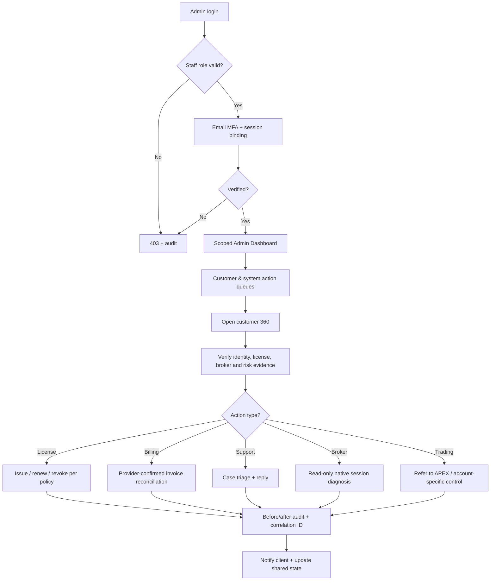
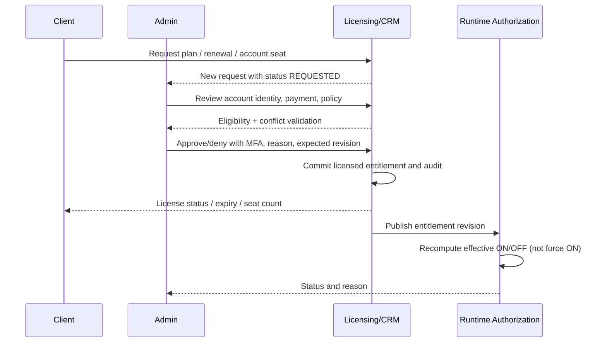

# ABUTRON | ADMIN-FLOW: Admin Portal Blueprint
**Document ID:** ABU-ADMIN-FLOW-20261113  
**Version:** 1.0 | **Audience:** Product, engineering, business operations, security, finance  
**Primary route:** `/account/admin/` | **Brand:** ABUTRON  
**Status terminology:** `OBSERVED` = directly inspected; `TARGET` = future workflow; `HISTORICAL` = older checkpoint.

## 1. Admin mission and security boundary
The Admin Portal is the commercial and governance control plane for customers, subscriptions, licenses, approved broker linking, support, billing, incident communication, and business reporting. It is **not** the native trade execution console. Its job is to maintain authorized customer-to-account entitlements and provide consistent operational context while preventing unauthorized cross-tenant actions.

**Observed limitation:** The current `/opt/apex-client-portal/apex_admin.py` module explicitly advertises `READ_ONLY` administration and email MFA. It does not expose direct role, payment, license mutation, broker credential, or trade-execution writes. The flows below that require writes are **TARGET** workflows, not asserted current capabilities.

## 2. Actor model and separation of duties
| Actor | Minimum scope | Representative capability | Explicit exclusion |
|---|---|---|---|
| Superadmin | Platform global | assign staff roles, policy management, approved exceptions | cannot silently submit trades |
| Client Operations | Assigned customers | approve identity/support tasks, broker-link investigations | cannot see raw MT5 passwords |
| License Admin | Licensed customers | issue/revoke/renew license seats within policy | cannot change billing ledger unilaterally |
| Finance/Billing | Paid subscriptions/invoices | reconcile payment, issue approved invoice/refund events | cannot override broker execution gates |
| Support | Assigned cases | triage, communicate, case state | cannot edit licenses or risk |
| Risk Viewer | Scope-limited operational risk | inspect owner-wide risk and incident evidence | cannot dispatch orders |
| Compliance/Auditor | Audit and approved evidence | export redacted event chain, investigate anomalies | no mutation rights |
| APEX Operator | APEX Portal only | monitor health and controlled interventions | cannot grant subscriptions |
| Background Job | Single service identity | webhook/renewal/notifications/reconciliation | cannot impersonate interactive admin |

**Current known implemented role:** `SUPERADMIN` with email-bound MFA; additional granular roles above require explicit implementation and migration. Never treat a role label in the frontend as backend enforcement.

## 3. Admin navigation / information architecture
```text
/account/admin/
  /overview                   TARGET landing
  /customers                  TARGET directory + segments
    /:customer_id             TARGET customer 360
  /broker-connections         TARGET account mapping and health
  /licenses                   TARGET issuance / renewal / suspension
  /subscriptions              TARGET plans, seats, expirations
  /billing                    TARGET payments, invoices, refunds
  /execution-readiness        TARGET read-only effective ON/OFF matrix
  /risk-and-exposure          TARGET read-only owner exposure and exceptions
  /support                    TARGET case queue
  /notifications              TARGET templates and communication history
  /prop-firm                  TARGET separate product administration
  /ab-markets                 TARGET future placeholder until launch
  /reports                    TARGET KPIs, exports
  /audit                      TARGET append-only action history
  /staff-and-roles            TARGET Superadmin-controlled roles
  /settings                   TARGET policies/integrations/provider readiness
```
Paths are logical view proposals; existing V7 admin frontend and admin API may use different internal routes.

## 4. End-to-end administrative journey




## 5. Admin authentication and privilege lifecycle
**A01 - Staff login.** Existing client identity login followed by Superadmin role check. Verify staff email status and role grant source. Separate staff sessions from customer sessions and do not trust only a frontend cookie flag.

**A02 - MFA.** Email challenge bound to role, session, account and challenge nonce; configured expiration, attempt limits, replay prevention; success yields short-lived verified admin session. Current code includes `/account/api/client/admin/mfa/request` and `/mfa/verify`, with a configured 600-second MFA lifetime in `apex_admin.py`.

**A03 - Step-up authentication.** Require fresh MFA before granting/revoking staff roles, large license changes, billing correction, account transfers, or bulk exports. For approved sensitive actions, require a typed reason and expected revision.

**A04 - Session revocation.** Admin logout and forced logout on role revocation/compromise; session credentials stored hashed, cookies secure and HttpOnly, audit on authentication anomalies.

**A05 - RBAC/ABAC.** Authorization must evaluate staff role, resource scope, customer tenant, purpose of access, sensitivity, and action class. Every admin API call must enforce these checks server-side, including exports and bulk operations.

## 6. Admin overview dashboard
| Panel | Data | Business action |
|---|---|---|
| Customers | total, verified, trial, active, suspended, new signups | open customer directory |
| Revenue | paid subscriptions, invoiced vs settled, overdue, refunds | open billing queue |
| Licenses | active, expiring 7/30 days, revoked, seats utilized | renewal work queue |
| Broker links | authenticated, pending, disconnected, stale, failed workers | connection diagnostics |
| Trading controls | requested ON, effective ON, blocked, LIVE/DEMO split | investigate state mismatch |
| Execution evidence | confirmed broker fills, open-protected, unknown receipts, reconciliation freshness | deep link to APEX incident |
| Support | unassigned, urgent, SLA overdue, awaiting customer | assign/support actions |
| Infrastructure | service health summary, feed freshness, error count | operator dashboard deep link |

Define each metric's query, time window and source. Do not use “active trading accounts” to mean “enrolled account records.” If billing provider settlement isn't verified, show `unreconciled` rather than revenue collected.

## 7. Customer management flow
**A10 - Customer directory.** Search/filter by email, status, join date, plan, broker, environment, support severity and license expiry. Display masked identifiers, no broker passwords. Include pagination, stable sort and export role limitations.

**A11 - Customer 360.** Tabs: Overview; Verified Identity; Broker Accounts; Trading Control State; License/Subscription; Invoices; Support; Trade Evidence Summary; Audit Timeline; Notifications. Profile contains customer ID and immutable creation time.

**A12 - Customer statuses.** `PENDING_EMAIL -> ACTIVE_VERIFIED -> ACTIVE_LICENSED -> SUSPENDED / TERMINATED`; access, billing and trading are independent dimensions. Admin cannot grant verified broker status just by setting CRM record to CONNECTED.

**A13 - Customer correction.** Name/contact change request, profile repair, duplicate account merge only with proven ownership and reversible mapping; all affected foreign keys and sessions reviewed, MFA step-up for irreversible operations.

**A14 - Deactivation.** Display all linked broker accounts and open positions, pending invoices and support cases; update entry entitlement, retain read-only history and protective exit ability; audit effective runtime impact and notify customer.

## 8. Broker connection administration
**A20 - Connection directory.** View connection ID, owner, broker/server, environment, native login suffix, verified native broker ID, worker ID, last authenticated heartbeat, last position export, requested/effective control, license seat, status reason.

**A21 - Problem diagnosis.** Identify enrollment-only record vs authenticated native session; worker crash; MT5 terminal launch failure; EA load/bridge readiness; stale export; duplicate worker binding; broker server mismatch; account ownership overlap; reconciliation mismatch.

**A22 - Ownership transfer.** Do not allow simple account_id edit. Require verified client identity, broker ownership evidence, exit/protection review, old-account revoke, new-account connect, no double executor, and full audit.

**A23 - Broker support matrix.** Deriv DEMO/LIVE, FP Markets DEMO, IC Markets DEMO should be shown only as supported based on actual integration proof. Each environment and server choice has separate capability state. “Available in dropdown” ≠ “execution-certified.”

**A24 - Repair workflow.** Admin can create assigned technical incident with correlation ID and artifact pointers; operator reviews/repairs broker worker in APEX operations after backup/reconciliation. No raw shell/root access through generic CRM fields.

## 9. Licensing flow


**A30 - License catalog.** Product family, plan, feature flags, max connected accounts, environment entitlement, effective date, renewal rules and prices. Historical planned tiers: Starter; Professional; Enterprise 1, 2, 3. Actual deployed catalog must be read before pricing claims.

**A31 - New license.** Search verified customer -> check existing grant/seat conflicts -> choose plan + seat count + start/end -> preview entitlements and new-entry impact -> require authorized role/reason/MFA -> create license with version + audit -> notify customer -> recompute runtime eligibility. Successful license issue does *not* imply broker login or order permission.

**A32 - Renewal.** Verify provider settlement/manual exception and expected old expiry -> extend effective validity -> emit `license.renewed` with old/new state -> client notification. A renewal request and completed renewal are separate states.

**A33 - Pause/revoke.** Preview all affected accounts and open broker positions, prevent new entries per policy, keep protective management and report effective state; revoke session/seat only as appropriate. Never delete broker history.

**A34 - Seat controls.** An account seat binds one unique internal connection ID, owner and environment. Changing seat assignment creates a history record; do not count duplicates under different aliases.

**A35 - Entitlements.** Define feature flags explicitly: number of accounts, broker support, signal analytics, historical export, product tier, and trading-mode permissions. Feature flags should not hard-code license tier names in frontend bundles.

## 10. Subscription/billing flow
**A40 - Payment lifecycle.** `DRAFT -> INVOICE_CREATED -> PAYMENT_PENDING -> PROVIDER_CONFIRMED -> SETTLED -> ACTIVE`, with branches `FAILED`, `REFUNDED`, `CHARGEBACK`, `CANCELLED`. Payment confirmation must be signed/replay-safe and correspond to an amount, currency, invoice and customer.

**A41 - Finance workspace.** Invoices, provider transaction ID, settlement ledger, tax status, renewal dates, dunning, bank/provider reconciliation and refunds. Mask personal payment identifiers. Platform fees and customer's MT5 broker cash are separate; do not mingle them.

**A42 - Provider readiness.** Historical Stitch Express integration/tests existed but actual live collections/settlement were not independently confirmed. Current client `/license/summary` endpoint reports `payment_provider_connected=false`; billing UI must follow real readiness and clearly identify manual/pending states.

**A43 - Refund/chargeback.** Role-limited request -> evidence/reconciliation -> policy and finance approval -> provider acknowledgment -> subscription update -> email -> immutable event trail. Subscription downgrades must not silently close broker positions.

**A44 - Reporting.** MRR, ARR, churn, renewals, conversion, overdue, ARPU only after definition of revenue recognition and settlements. Show data quality and date range on every report.

## 11. Trading/risk administrative oversight
**A50 - Effective state matrix.** Each row: customer, account, broker, mode, requested ON, effective ON, reason codes, last decision, authenticated broker evidence, risk provenance, last reconcile, pending ACKs. Operator owns debugging execution, not license desk.

**A51 - Risk inspection.** Current per-trade configuration, actual risk in USD/account currency, owner-wide portfolio ceiling 20%, native stop coverage, unknown/disconnected exposure, breach history. This is a read-only customer-support/compliance view unless separately authorized policy endpoint exists.

**A52 - Incidents.** Escalation states `DETECTED -> ACKNOWLEDGED -> ASSIGNED -> INVESTIGATING -> MITIGATED -> RESOLVED -> VERIFIED`; attach service state, evidence timestamps, owner impact and APEX correlation ID. Never label a failed reconciler as healthy merely because portal HTTP API responds 200.

**A53 - Customer-facing correction.** If CRM displays ON while worker cannot execute, show explicit discrepancy, do not alter broker evidence to match UI; trigger state recalculation from native sources.

**A54 - LIVE governance.** Admin license grant is not LIVE trading authorization. A separate genuine broker account, LIVE entitlement, source-backed risk and approved runtime activation must be explicit and auditable.

## 12. Support operations
**A60 - Support queue.** Filters: `NEW`, `TRIAGED`, `IN_PROGRESS`, `WAITING_CUSTOMER`, `ESCALATED_APEX`, `RESOLVED`, `CLOSED`; severity P1–P4; owner, SLA and customer impact.

**A61 - Case detail.** Customer identity; linked connection suffix; timestamps; reason codes; secure attachments; redacted execution trace; notification log; internal notes; resolution tests.

**A62 - Escalate to APEX.** Include customer ID/connection ID, affected broker, times, source hashes, redacted logs, expected vs observed state, ticket references and requested remediation. No credential payload.

**A63 - Contact customer.** Template-driven, customer preference aware, approved sender, delivery/retry status. Do not say an account is connected, paid or trading unless back-end evidence supports it.

**A64 - Close case.** Document root cause, correction, native evidence or remaining limitation, customer notification and follow-up criteria. A P1 incident needs postmortem linkage.

## 13. Compliance, audit, monitoring and security
**A70 - Admin audit.** Append-only events for admin login/MFA, role grants, customer edits, license changes, payment status changes, support access, exports and abnormal denied requests. Required fields: actor, role, resource, tenant, reason, before/after, timestamp, session, correlation, outcome.

**A71 - Data access.** Personal data redaction, scoped export, retention policy, privacy requests; sensitive records accessed only with purpose. Audit exports should be tamper-evident and selectively redacted.

**A72 - Backups/recovery.** Display latest verified backup *as evidence*, not from a historic string. Show restore test status separately. Admin does not trigger irreversible infrastructure restores from a casual one-click UI.

**A73 - Integration state.** Email provider delivery, payment provider, CRM DB, broker worker manager, support notification channel, APEX operator API. Distinguish provider configured, tests passed, production authenticated, and operation settled/confirmed.

**A74 - Platform security.** MFA, least privilege, session expiry, CSRF, rate limiting, signed service communication, DB protection, webhooks with replay protection, dedicated service identities and logs without secrets.

## 14. Admin API contract
### 14.1 OBSERVED current read-only admin routes
```text
GET  /account/api/client/admin/me
GET  /account/api/client/admin/overview
GET  /account/api/client/admin/runtime-health
GET  /account/api/client/admin/fp-native-history
GET  /account/api/client/admin/fp-market
POST /account/api/client/admin/mfa/request
POST /account/api/client/admin/mfa/verify
POST /account/api/client/admin/logout
```
The observed admin overview explicitly reports `admin_mode=READ_ONLY`. Individual roles, billing and license mutation services may exist outside this visible web route; this review does not certify them as reachable.

### 14.2 TARGET versioned endpoints; not deployed claims
```text
GET  /api/v1/admin/customers?query=...&status=...
GET  /api/v1/admin/customers/{customer_id}
PATCH /api/v1/admin/customers/{customer_id} (expected_revision, reason, MFA)
GET  /api/v1/admin/broker-connections?broker=...&status=...
GET  /api/v1/admin/licenses?status=...
POST /api/v1/admin/licenses (actor scope, expected revision, reason)
POST /api/v1/admin/licenses/{id}/renew (idempotency_key)
POST /api/v1/admin/licenses/{id}/suspend (step-up MFA)
GET  /api/v1/admin/invoices
POST /api/v1/admin/refunds (finance approval workflow)
GET  /api/v1/admin/execution-readiness (read-only)
GET  /api/v1/admin/incident-queue
POST /api/v1/admin/support-cases/{id}/assign
POST /api/v1/admin/support-cases/{id}/resolve
GET  /api/v1/admin/audit-events?from=...&to=...
POST /api/v1/admin/roles/grant (Superadmin + step-up + audit)
```
All mutations must be scoped server-side and recorded atomically with audit.

## 15. Admin data and event lifecycle
**Core entities:** Customer, AccountVerification, BrokerConnection, License, LicenseSeat, Subscription, Invoice, PaymentProviderEvent, StaffRoleGrant, StaffMFASession, SupportCase, CustomerNotification, Incident, AuditEvent. Use stable internal keys and migrations with referential integrity.

**Admin event examples:** `customer.reviewed`, `customer.suspended`, `connection.investigation_started`, `license.issued`, `license.renewed`, `license.revoked`, `payment.provider_confirmed`, `support.case_escalated`, `staff.role_granted`, `admin.export_created`. Every event must be replay-safe or explicitly non-replayable based on effect type.

## 16. Acceptance and regression matrix
| ID | Scenario | Required outcome |
|---|---|---|
| ADMIN-01 | Customer attempts Admin URL | 403; no privileged data |
| ADMIN-02 | Admin has role but no valid MFA | no overview or mutation until verified |
| ADMIN-03 | MFA code reused | rejected, audited |
| ADMIN-04 | Support changes license directly | forbidden server-side |
| ADMIN-05 | License issue request duplicated | idempotent / conflict, no extra seat |
| ADMIN-06 | License expires with protected broker position open | new entries off; protection/exit retained |
| ADMIN-07 | Broker record enrolled but not authenticated | shown pending, not CONNECTED |
| ADMIN-08 | Provider webhook replay | one settlement event, not double-charge/license |
| ADMIN-09 | Admin marks broker repair complete without proof | cannot declare verified trade capability |
| ADMIN-10 | Cross-tenant export via altered ID | denied; audit includes actor and scope |
| ADMIN-11 | Revoked staff role session | subsequent request fails |
| ADMIN-12 | APEX down | explicit degraded operator status, CRM still accessible |
| ADMIN-13 | DB backup snapshot exists but not restore-tested | status correctly says untested |
| ADMIN-14 | Customer requests LIVE without approved entitlement | no automatic enable from admin license |
| ADMIN-15 | Mobile/keyboard/low vision | navigation and forms accessible |

## 17. Layout wireframe
```text
+----------------------------------------------------------------------------------+
| ABUTRON ADMIN | Customers | Licensing | Billing | Broker Links | Support | Audit |
+----------------------------------------------------------------------------------+
| [Admin MFA: VERIFIED] [Role: SUPERADMIN] [Data freshness] [Audit export]          |
|----------------------------------------------------------------------------------|
| [Active Clients] [Renewals Due] [Pending Support] [Blocked Trading Accounts]       |
|----------------------------------------------------------------------------------|
| WORK QUEUE                          | CONNECTIVITY / EXECUTION EXCEPTIONS          |
| - Customer verification             | FP 0512 - stale receipt - operator case     |
| - License approval                  | Deriv 6207 - requested ON / effective OFF   |
| - Payment pending                   | UNKNOWN broker owner exposure               |
|----------------------------------------------------------------------------------|
| Customer 360: Identity | Accounts | Entitlement | Invoice | Cases | Audit          |
+----------------------------------------------------------------------------------+
```

## 18. Build sequencing / evidence closure
1. **P0:** Reconcile admin code + currently deployed V7 frontend + actual DB schema and staff roles; no writes; record route/permission inventory.
2. **P1:** Define role matrix, MFA and audit storage; test roles before any mutation endpoints.
3. **P2:** Customer 360 and connection evidence, with true enrolled/authenticated separation.
4. **P3:** License/seat request, approval, renewal and revocation with backend revisions and event delivery.
5. **P4:** Billing provider confirmation and reconciliation, then reports and support automation.
6. **P5:** Incident and risk view linked to APEX; do not duplicate broker-order authority in Admin.

**Admin success condition:** Staff can explain and prove who a customer is, what the customer bought, which broker sessions are authentic, why trading is effectively ON/OFF, which support actions were completed, and exactly who changed which policy—without gaining unnecessary access to live order submission.