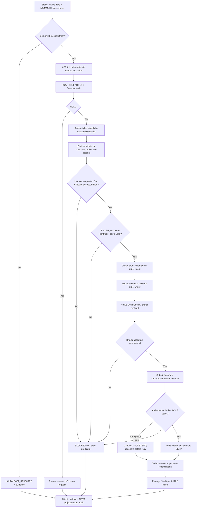
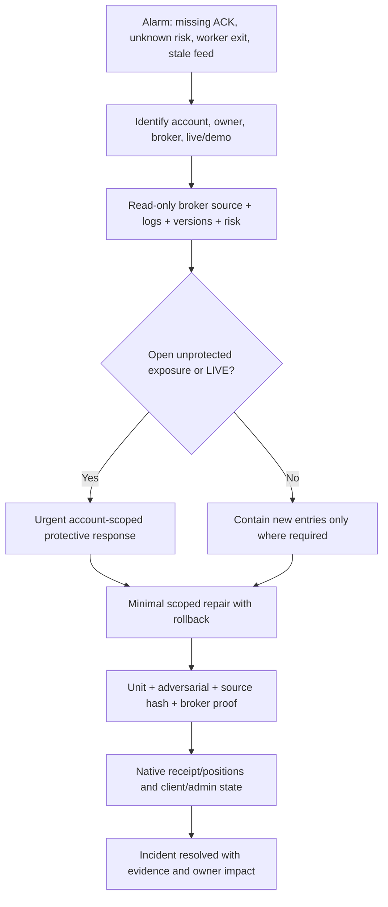

# ABUTRON APEX | APEX-FLOW: Operator Portal and Execution Blueprint
**Document ID:** ABU-APEX-FLOW-20261113  
**Version:** 1.0 | **Primary route:** `/apex/` | **Engine:** APEX 1.1  
**Audience:** Trading engineering, production operations, risk, QA, incident response  
**Status:** Detailed *target architecture* with evidence references to observed 2026-11-13 code; no claim that every broker execution path currently works.

## 1. Operator mission
APEX is the engineering/operational center for the APEX 1.1 decision engine, account-bound market feeds, signal prioritization, adaptive risk sizing, exclusive native MT5 order dispatch, broker receipt reconciliation, protected position lifecycle, multi-account/customer portfolio risk, infrastructure health, and incident response. Its UI must not be the source of trading truth; broker-native receipts and account position exports are.

**Execution architecture principle:** `Broker-native feed -> APEX 1.1 decisions -> deterministic eligible candidate ranking -> account authorization -> adaptive risk & cost check -> exclusive native writer -> broker acceptance -> protected open position -> manage/close -> broker-native reconciliation -> client/admin readouts`.

**Excluded from target execution path:** Kronos execution vetoes, TradingAgents reviewers, Qwen factor gating, SMC/ICT vetoes, Hermes middleware and research minimum-hour/day counters. Existing historical code may be separately archived/reviewed; no deletion or deployment is authorized by this document.

## 2. Operator personas and access
- APEX Observer: read-only diagnostics, strategy decision provenance, feed freshness, broker evidence and incidents.
- Broker Operations: inspect connection/worker/EA health, safely initiate non-trading read-only rechecks, escalate necessary restarts.
- Risk Operations: inspect owner-wide risk and policy discrepancies, trace stop protection, verify account-specific per-trade policy.
- Execution Operator: limited ability to request approved, account-scoped operational actions through controlled service actions; not a general arbitrary command endpoint.
- Superadmin: platform administration in Admin Portal; APEX read privileges as assigned, not automatically native order authority.
- Service identity: APEX publisher read-only; risk/admission service; exclusive broker writer; independent broker reconciler. Keep permissions and data access separate.

## 3. Operator navigation and screen map
```text
/apex/
  /overview                   TARGET operations landing
  /engine                     TARGET APEX 1.1 model/version/status
  /feeds                      TARGET native symbols/timeframes/data integrity
  /signals                    TARGET BUY/SELL/HOLD decisions and features
  /candidate-ranking          TARGET eligible candidates and selection proof
  /broker-accounts            TARGET broker-account/session inventory
  /execution                  TARGET intent -> OrderCheck -> send -> ACK
  /positions                  TARGET broker-native open/close and SL/TP
  /risk                       TARGET adaptive per-trade + owner-wide exposure
  /reconciliation             TARGET orders/deals/positions/unknown receipts
  /performance                TARGET net results, costs, attribution
  /incidents                  TARGET root cause, severity and response
  /infrastructure             TARGET workers/timers/services/versions/health
  /audit-and-releases         TARGET source hashes, release/rollback evidence
```
Proposed logical pages; actual 2026-11-13 operator API uses FastAPI routes under `/opt/apex/runtime/apex_ui/app.py` and Caddy `/apex/*` mapping. Current operator endpoint responses are explicitly read-only for key research/health pages.

## 4. Complete signal-to-broker execution flow




## 5. APEX operator overview
| Widget | Meaning | Evidence source |
|---|---|---|
| Engine | APEX 1.1 version/hash, current mode, last successful decision | approved version manifest and publisher journal |
| Feed coverage | native broker symbols/timeframes, last bar, delays and malformed bars | account-bound broker feed journal |
| Decisions | BUY/SELL/HOLD counts, fresh/expired, rejected and dispute reasons | exact decision ledger |
| Accounts | connected workers, verified broker identity, requested/effective state | CRM + manager + native account header |
| Orders | attempts, native accepted/rejected, unknown, protected open | dispatcher intents + broker receipts |
| Owner risk | known protected stop-risk, 20% portfolio ceiling, missing exposure | cross-account native risk join |
| Reconciliation | receipt lag, native positions, missing SL/TP, mismatch | independent read-only reconcilers |
| System | services, last success/failure, versions, hash pins, backup proof | systemd, log audit, release manifest |
| Incidents | severity, affected accounts and orders, mitigation | incident event stream |

**Truth labels:** `RESEARCH`, `INTENT_CREATED`, `BROKER_SUBMITTED`, `BROKER_ACKNOWLEDGED`, `POSITION_PROTECTED`, `RECONCILED`, `STALE`, `UNKNOWN`. Never collapse these stages into a binary green `TRADING` label.

## 6. Account / broker inventory workflow
**P01 - Account discovery.** Display unique internal connection ID, broker, account suffix, DEMO/LIVE, account owner, verified broker login/server, worker PID/heartbeat, native feed age, attached EA/bridge capability, strategy version, trade-control revision, per-trade policy and reconciliation health. Require authorization to reveal any customer-identifiable data.

**P02 - Known project inventory, verification required.** Historical Deriv DEMO: 6207, 7593, 9244; Deriv LIVE: ···0178; FP Markets DEMO: 0512, 1636, 1622, 6310 and later other accounts depending on actual CRM enrollment. 2026-11-13 operator API reported 6 account publishers, 5 fresh; do not assume all historic accounts are healthy or active in exactly the same way.

**P03 - Broker-native session check.** Worker process running alone is not proof of authenticated trading terminal. Verify native login, server, account currency, trade mode, native heartbeat, export timestamp, broker configuration and chart/EA initialization against account binding.

**P04 - EA and single-writer attestation.** Confirm intended EA compiled binary/source hash, correct chart and symbol, correct account login, WebRequest permission if used, native ACK channel and order writer ownership. For account-specific FP workers, do not let duplicate server links create second native writer.

**P05 - Connection degradation.** States: `CONNECTED_VERIFIED`, `FEED_STALE`, `WORKER_EXITED`, `EA_UNINITIALIZED`, `BROKER_AUTH_FAILURE`, `BRIDGE_NOT_READY`, `RECONCILE_BLOCKED`, `UNKNOWN_RISK`, `RECOVERING`. Show exact components, last known-good timestamps and independent read-only checks.

## 7. Market feed and instrument workflow
**P10 - Feed ingestion.** Broker worker exports ticks and closed bars with broker server time/UTC normalization, symbol, digits, point, tick size/value, stop/freeze level, spread, contract specification, trade session status, bid/ask, margin constraints and feed version.

**P11 - Bar correctness.** Close-time aligned M5/M15/H1 bars only for decisions; no incomplete current candle as closed. Deduplicate on account/broker/symbol/timeframe/close-time/source revision. Data gap, out-of-order or timestamp skew produces HOLD or degraded evidence.

**P12 - Broker symbol catalog.** Never assume Deriv V50 maps directly to FP GBPUSD.r. Support per-broker contract specs, current spread, stops, trade sessions, minimum/maximum lot and step, netting vs hedging and quote currency. Record any unsupported symbol as explicit `NOT_TRADABLE`.

**P13 - Feed operator page.** Filter broker/account/symbol/timeframe, visual OHLC, last 100 bars, feed completeness, sequence gap, chart vs broker timestamp, spread/cost distribution and reason for exclusion. Instrument records must be versioned and bound to broker environment.

## 8. APEX 1.1 decision pipeline
**P20 - Decision formation.** For a valid closed bar, engine calculates supported APEX 1.1 features and score, then produces immutable `decision_id`, `account_id`, `symbol`, `side` (BUY/SELL/HOLD), `score/confidence` as defined by the actual engine, bar close UTC, model/version hash, timeframe metrics, cost estimate, reason codes and input data digest. Do not imply a probabilistic confidence is calibrated without verification.

**P21 - Timeframe disagreement.** Display M5, M15, H1 directional evidence side-by-side and decision rule. Historical 2026-11-11 review found Deriv bridge weights M5 0.25, M15 0.375, H1 0.375; opposing M15+H1 could cancel and permit a BUY despite M15 SELL. Blueprint requires explicit configurable, testable conflict handling, direction attribution and archived feature-level rationale; no magic defaults.

**P22 - HOLD.** No order intent for HOLD, missing features, expired signals, spread disqualification, unsupported market, insufficient risk headroom or nontrading session. Journal the exact reason, bar ID and predicate evaluation.

**P23 - Selection/ranking defect correction.** Historical source audit found FP routers selecting first candidate sorted by `(closed_bar, symbol)` and Deriv drafts iterating alphabetically; thus symbol name, not conviction, could pick an entry. Target order selection must sort eligible decisions by **validated normalized conviction**, liquidity/cost suitability and timestamp, then deterministic tie-breaker. Persist ranking vector and all considered candidates. Validate selection parity across Deriv/FP and versions. APEX confidence scoring must be sourced from the actual strategy, not invented in UI.

**P24 - Multi-position and conflict.** Account-specific policy defines concurrent protected positions, symbol concurrency, opposing-direction hedging/netting restrictions and per-owner exposure. Historical `flat-only` constraint needed repair. Never treat an existing protected position as proof that all additional entries are prohibited; also never open uncontrolled stacked exposure.

**P25 - Research/production separation.** Publishers generate decisions and evidence, not orders. `RESEARCH` (staging/observational) must never be described as `EXECUTING`; an order only exists after exclusive writer and broker ACK evidence.

## 9. Eligibility and runtime activation
**P30 - Contract.** Order candidate must pass authenticated account ownership, client requested ON, backend effective ON, license seat/environment, broker trade permission, symbol support, fresh native feed, unique decision, proper EA/worker binding, owner-wide risk inventory and exact risk policy revision.

**P31 - Requested vs effective.** Admin license issue does not force ON. Client request ON does not force ON. Effective ON is recomputed on any relevant change, with event and timestamp. An active market signal is not a bypass.

**P32 - Time bounds.** Validate actual bar close and decision creation, expiration and issuer identity. Do not install arbitrary 100-second expiry or fixed candle-count acceptance thresholds unless they are explicitly part of the agreed strategy contract; use evidence-driven freshness policy with tests.

**P33 - Client OFF.** On account-specific OFF, stop accepting new intents, cancel unsent queued intents, retain native position protection and close/reconcile service. Show final admission revision and runtime acknowledgment. Never make `OFF` mean “delete open positions” automatically.

**P34 - Active LIVE separation.** LIVE 0178 is a historical account, not a proof of a funded, running, permitted writer. LIVE needs independent connection and explicit authorized execution settings. No cross-environment token/EA routing.

## 10. Adaptive position sizing and portfolio risk
**P40 - Risk inputs.** Equity/balance in account currency; live quote and spread; actual contract size, tick/point value; broker minimum lot and lot step; side, entry, stop distance, slippage assumptions, commission/swap; correlated owner-wide exposure; account environment and risk policy.

**P41 - Sizing:** `risk_budget = verified_equity × configured_per_trade_pct / 100`; `unit_stop_risk = |entry - stop| / tick_size × tick_value (+ admissible costs)` using exact broker specs; `raw_lots = risk_budget / risk_per_lot`; round **down** to broker step, then re-evaluate margin, stops and net risk. Reject if minimum feasible size exceeds budget. Account currency conversions explicit and timestamped.

**P42 - Portfolio ceiling.** Requested owner-wide ceiling is **20%**, across relevant linked accounts with independent broker-native stop-loss exposure. Stop risk must be recomputed from actual native positions after entry, stop changes, fills and account reconnect. Unknown linked-account exposure is not zero; mark `UNCERTIFIED_OWNER_RISK` and prevent unsafe new entries.

**P43 - Trade risk ambiguity.** Historic project settings: 0.10%, requested 0.15%, requested 0.20%. Current deploy is not established by this document. Show effective account-specific live revision and audit. Never publish a fixed “0.20% active” banner without actual policy evidence.

**P44 - Protected position lifecycle.** Require broker-verified SL/TP; discriminate valid tightened trailing SL versus widened risk. Revised trailing stops may reduce USD stop-risk; do not block genuine protective tightening, but recalculate risk consistently for partial fills/partial closes.

**P45 - Multi-trade management.** Enforce account and owner risk budgets before *each* prospective entry, including already open protected positions and pending broker intents. Concurrency-safe admission reservation and post-fill reconciliation prevent racing dispatchers from each consuming the same headroom.

**P46 - Risk exception UI.** Show pre-trade estimate, allowed budget, effective lot, native stop, provider costs, margin, cumulative owner risk, data age, and exact deny predicate. No hidden strategy vetoes or fabricated approval statuses.

## 11. Exclusive native order dispatcher
**P50 - Single writer contract.** Exactly one active order-capable writer per account/environment, with durable lease/fencing token and broker identity hash. Read-only publishers and dashboards cannot call OrderSend. Detect and reject a second dispatcher or incompatible EA instance.

**P51 - Idempotency.** Compute key from stable account/decision/strategy/symbol/side/bar-close and approved intent revision. Atomically persist intent before dispatch. On timeout, first query journal and broker receipts; do not blindly retry native submission.

**P52 - Broker preflight.** Verify trade session, symbol, fill policy, broker OrderCheck, lot constraints, SL/TP minimum stop distance, margin, spread/cost and correct account. Persist request+response and engine/policy hashes without secrets.

**P53 - Order submission.** Dispatch via account-specific native MT5 bridge only after all admission predicates pass. Capture send attempt ID, native error/result, order/deal/position identifiers, broker server time and requested SL/TP; do not regard process exit status 0 as broker acceptance.

**P54 - Acknowledgment.** Receipt states `SENT_UNCONFIRMED`, `REJECTED`, `ACCEPTED`, `PARTIAL_FILL`, `OPEN_PROTECTED`, `UNKNOWN`. Native broker evidence must prove filled side, symbol, lots, account, stop/take and current position state.

**P55 - Stop protection.** If broker accepts but stop attachment is not proven, raise `UNPROTECTED_INCIDENT` and follow authorized position-repair/exit workflow. Do not silently leave unprotected exposure because a portal green check exists.

**P56 - Restart/recovery.** Restore durable intents and broker ticket maps, reacquire exclusive lease, reconcile all native positions and unconfirmed orders before new sends. No duplicate orders after service crash or MT5 worker restart.

## 12. Native broker reconciliation
**P60 - Independent read-only reconciler.** Join local intent and recorded broker ACK to authoritative native orders/deals/positions/history; compare by verified account ID, symbol, ticket, timestamps, quantity, SL/TP and state. Report `RECONCILED`, `PENDING`, `UNKNOWN`, `MISMATCH`, `STALE`, `UNVERIFIED` per account.

**P61 - Full position lifecycle.** Track partial fills, modified stop/TP, trailing stop, position netting, closures, cancel, broker rejection, re-entry and deposit/withdrawal events. An apparent position absence may be a data gap until native history proves close.

**P62 - Cross-broker owner aggregation.** Compose authenticated owner across Deriv/FP/other approved brokers and disconnected accounts. Avoid one failed ancillary account blocking display of correctly verified per-account cashflow, but never declare *all-owner risk certified* if another account is unknown.

**P63 - Time coherence.** Timestamp each source and join at compatible snapshots; transient mismatches during genuine broker stop changes must transition to pending/verification rather than false historical rewrite. Define freshness SLOs per feed, history and risk (configured, not assumed identical).

**P64 - Reconciliation repair.** New pin/source mismatch, stale native evidence, uninitialized EA, missing receipt, wrong terminal account, stop-tightening parser defect each has separate diagnostic branch and repeatable test. Existing 2026-11-13 repairs should be inspected rather than assumed universal.

**P65 - Account evidence export.** JSON/CSV manifest with account, time window, native source hashes, broker receipts, unknown count, risk and failing predicates. Export must redact secrets and customer PII based on operator role.

## 13. Positions and performance
**P70 - Position board.** Broker, account, DEMO/LIVE, ticket, symbol, side, lots, initial entry, native current SL/TP, USD/account-currency risk, realized/unrealized P&L, age, last export timestamp, protection state.

**P71 - Trade attribution.** Join decisions to native deals including broker fees, swaps, spread/slippage estimate and realized net P&L. Multiple fills for one intent and multiple deals for one position require many-to-many mapping or normalized lifecycle tables.

**P72 - Metrics.** Profit factor, realized expectancy, win rate, average R, MAE/MFE (if data valid), drawdown, average execution latency, rejected/unknown receipt rate, stop protection rate, account coverage; show sample size, date, cost attribution and unresolved data gaps. No “profitable” label without broker-native evidence and window definition.

**P73 - Historical strategy audit.** Compare direction against M5/M15/H1 and broker execution entry price. Reproduce losing trades with their exact model version, signal vintage, prior closed bars and costs. Selection defects are tested as code defects, not patched with arbitrary UI labels.

## 14. Operator incident handling


**P80 - Incident severity.** Critical: broker-native open exposure without verified protective stop; duplicate writer; wrong account/env execution; risk ceiling exceeded. High: unknown native receipt, stale owner risk, broker worker crash, repeated false control ON. Medium: delayed diagnostics/metrics without order path impact. Distinguish `FAILED service` from `inactive completed one-shot`.

**P81 - Root-cause worksheet.** Trigger; affected account(s); timestamp; expected vs observed; systemd unit and exit code; source SHA, deployed binary SHA and bridge chart; native account identity; fresh broker state; audit/rollback paths; tests; final effective state.

**P82 - Repair discipline.** Prechange snapshot/backup and rollback design; smallest code patch; source pin and binary consistency; focused negative tests (wrong owner, duplicate order, widened stop, stale evidence); dry-run/read-only check; controlled DEMO broker proof; monitor post-deploy. Do not silently modify LIVE settings.

**P83 - Reconciliation-first handling.** If broker history may be lagging a worker snapshot, do not issue compensatory orders. Treat pending receipt as UNKNOWN and independently query broker before deciding on remediation.

**P84 - Escalation.** Escalate commercial/identity/licensing problems to Admin; customer communication through Client + Admin notifications; execution and broker platform incidents stay in APEX. Cross-portal incident correlation must be stable.

## 15. Infrastructure and release management
**P90 - Service status.** Present unit name, description, enabled/active/failed state, last attempt, last completed success, timer cadence, account scope, execution authority `READ_ONLY`/`ORDER_CAPABLE` and entrypoint path. Avoid interpreting all inactive transient services as failed.

**P91 - Runtime version tracking.** Track production Python sources, signed release/version, SHA256, compiled EA hashes, current chart instance, worker version, policy revision, schema migration and Git commit if established. Do not assume deployed `/opt` directories are version-controlled repositories.

**P92 - Backups and restore.** Latest restic/offsite snapshot ID and verified restore status only from recent direct evidence; include DB-consistent snapshot capability, code/EA release bundle, order intent ledger, CRM state and broker-native evidence export. A backup exists != a recovery has been tested.

**P93 - Telemetry SLOs (proposed values must be tuned).** Native account heartbeat freshness, M5 publication latency, decision-to-send latency, send-to-ACK latency, history lag, unknown receipt duration, reconciliation coverage, owner risk coverage, uptime. Show percentile and source sampling; threshold changes via configuration and audit.

**P94 - Resource budget.** Run on existing authorized Ubuntu infrastructure unless capacity evidence requires more. Use per-account workers, avoid duplicative AI model serving and nonessential servers; prioritize reliability and restore readiness.

## 16. Current operator API inventory (OBSERVED 2026-11-13)
Current `/opt/apex/runtime/apex_ui/app.py` FastAPI GET routes include:
```text
/                              (operator home)
/api/apex11-engines            (read-only account publisher/engine status)
/api/apex11-broker-evidence    (read-only bridge/broker evidence)
/api/runtime-health            (read-only runtime health)
/api/overview                  (dashboard)
/api/broker                    (broker status)
/api/scanner                   (scanner)
/api/risk-governor             (risk)
/api/demo-auto                 (legacy/demo telemetry)
/api/order-prechecks           (prechecks)
/api/execution-preview         (preview)
/api/decision-intelligence     (decision diagnostics)
/api/fp-market                 (FP overview)
/api/fp-market-accounts        (FP account inventory)
/api/fp-market-account         (selected FP account)
/api/fp-market-account-chart   (FP chart)
/api/fp-native-history         (native FP history)
/api/fp-quality-diagnostics    (FP quality)
/api/chart                     (symbol chart)
/api/candle-comparison         (multi-timeframe comparisons)
```
`/api/agent-stack`, `/api/quant-first`, `/api/ai-smc-ict-status` are existing historical telemetry routes, not authority to restore excluded research/veto dependencies. They should be clearly marked legacy and retired from production menus after dependency audit.

### 16.1 OBSERVED operator engine state at 2026-11-13 15:36 UTC
```json
{
  "schema": "abutron.apex11.operator_dashboard.readonly.v1",
  "engine": "APEX 1.1.0",
  "fresh_account_publishers": 5,
  "total_account_publishers": 6,
  "orders_submitted_by_publishers": null,
  "fp_apex11_engine_link_verified": false
}
```
**Interpretation:** five of six observed research publishers were reported fresh at that time; this response does not verify broker order placement. It explicitly leaves FP APEX engine link not verified. Do not infer platform readiness from a healthy HTTP status.

### 16.2 TARGET versioned API contracts; not deployed claims
```text
GET  /api/v1/apex/accounts?broker=...&environment=...
GET  /api/v1/apex/accounts/{id}/execution-readiness
GET  /api/v1/apex/accounts/{id}/native-risk
GET  /api/v1/apex/feeds?account_id=...&symbol=...
GET  /api/v1/apex/decisions?from=...&to=...
GET  /api/v1/apex/decisions/{id}/features
GET  /api/v1/apex/decisions/{id}/candidate-ranking
GET  /api/v1/apex/executions/{intent_id}/trace
GET  /api/v1/apex/reconciliation?account_id=...
GET  /api/v1/apex/owner-exposure?owner_id=...
GET  /api/v1/apex/incidents?state=...
POST /api/v1/apex/incidents/{id}/ack (audited, scoped)
POST /api/v1/apex/accounts/{id}/reconcile-readonly (idempotent)
GET  /api/v1/apex/releases/source-manifest
```
Any future mutation/action endpoint needs policy approval, narrowly scoped service implementation, audit and user-facing confirmation; avoid generic arbitrary shell access from a public portal.

## 17. Internal event and data contracts
```text
DecisionGenerated(id, account, symbol, bar_close, side, feature_digest, model_hash)
CandidateRanked(decision_id, account, rank, score_components, tie_breaker)
AdmissionEvaluated(decision_id, account, desired_state, effective_state,
                    owner_risk_pct, risk_policy_version, accepted, reason_codes)
OrderIntentCreated(intent_id, decision_id, idempotency_key, account, size, sl, tp)
NativeOrderCheck(intent_id, broker_code, retcode, quoted_at, effective_cost)
OrderSubmission(intent_id, dispatch_attempt, order_writer_id, lease_epoch, sent_at)
BrokerOrderReceipt(intent_id, order_id, deal_id, broker_time, status, native_hash)
PositionUpdate(account, ticket, volume, side, entry, sl, tp, stop_risk, native_time)
ReconcileResult(account, coverage, unknown_receipts, native_position_count,
                total_stop_risk, stale_sources, checked_at, result)
RuntimeStateChanged(account, requested, effective, reason_codes, revision)
IncidentRaised(correlation, severity, account, broker, evidence_refs)
```
Every event must include both server-observed UTC and broker-native timestamps, account binding, environment, schema version and source hash. Broker receipt correlation must withstand retries and reconnects.

## 18. Regression and acceptance matrix
| ID | Scenario | Pass criterion |
|---|---|---|
| APEX-01 | M5/M15/H1 disagreement | decision obeys versioned rule and records counterevidence |
| APEX-02 | Multiple symbols same bar | highest valid conviction selected; not alphabetical first |
| APEX-03 | APEX HOLD | no order intent created |
| APEX-04 | Client requests OFF immediately before dispatch | writer rejects new submission; existing positions protected |
| APEX-05 | Wrong client/worker account | denied, no broker order |
| APEX-06 | Duplicate decision and worker restart | at most one broker order; durable idempotency |
| APEX-07 | Broker send timeout after possible fill | UNKNOWN + reconcile, not blind retry |
| APEX-08 | Broker min lot > risk budget | reject; never round risk up |
| APEX-09 | Owner-wide unknown exposure | do not certify below 20% as safe |
| APEX-10 | Trailing SL tightened, risk lower | reconciler accepts verified tightening; no spurious risk increase |
| APEX-11 | Broker SL widened | detect elevated risk and escalate, not falsely reconcile |
| APEX-12 | FP receipt source pin stale | specific integrity blocker with source evidence |
| APEX-13 | Two native writers same account | lease/fencing rejects secondary writer |
| APEX-14 | DEMO approval token used on LIVE | denied by environment binding |
| APEX-15 | EA attached wrong chart/login | no effective ON; clear repair predicate |
| APEX-16 | Worker up but native history stale | show DEGRADED, not BROKER_VERIFIED |
| APEX-17 | Deposit/withdrawal inflates balance | separate from realized trade P&L |
| APEX-18 | Partial fills and partial closes | ledger maps all native deals accurately |
| APEX-19 | All orders broker ACK but one unprotected | block protection certification and raise incident |
| APEX-20 | Publisher 5/6 fresh, no execution ACK | operator correctly says research working, execution unverified |
| APEX-21 | DR restore with existing broker positions | native reconciliation before any new order |
| APEX-22 | Customer sees ON vs operator sees OFF | correlation highlights mismatch and source of truth |

## 19. Operator wireframe
```text
+---------------------------------------------------------------------------------------+
| ABUTRON APEX 1.1 | Overview | Feeds | Signals | Execution | Risk | Reconcile | Ops      |
+---------------------------------------------------------------------------------------+
| ENGINE: APEX 1.1 [Source/hash] [Research: 5/6 fresh] [Execution: NOT ATTESTED]         |
|---------------------------------------------------------------------------------------|
| Broker/account | Mode | Native Session | Requested | Effective | Writer | Reconcile    |
| Deriv ···6207  | DEMO | Verified?      | ON        | OFF       | UNKNOWN| STALE        |
| FP ···0512     | DEMO | Verified?      | ON        | ON?       | CHECK  | CHECK        |
|---------------------------------------------------------------------------------------|
| SIGNAL CANDIDATES & RANKING             | ADMISSION EXPLANATION                      |
| Symbol / M5/M15/H1 / score / decision  | owner risk + broker costs + reason codes   |
|---------------------------------------------------------------------------------------|
| NATIVE BROKER RECEIPTS                 | POSITIONS / SL-TP / UNKNOWN / HIST COVERAGE|
|---------------------------------------------------------------------------------------|
| INCIDENTS                              | SERVICES / RELEASE HASHES / BACKUP PROOF  |
+---------------------------------------------------------------------------------------+
```
Values with question marks are intentionally examples, *not* a live status representation.

## 20. Implementation roadmap and validation evidence
**Phase A - Baseline truth:** Read-only inventory of source, systemd units, MT5 chart attachments, worker credential access boundaries, last native login, CRMs, database schemas, risk policy and unknown receipts. Export a secret-excluded manifest with hashes and times.

**Phase B - Decision correctness:** Reproduce current entry direction and candidate ranking, fix only confirmed strategy/router defects, run deterministic tests and historical broker-native attribution. Preserve APEX 1.1 as sole production signal engine.

**Phase C - Per-account native assurance:** For every intended DEMO account, prove publisher -> eligible decision -> correct writer -> native broker ACK -> protected position -> read-only receipt reconciliation, with 0 UNKNOWN in measured window; document actual failures, not simulated success.

**Phase D - Multi-account owner risk:** Complete cross-broker owner inventory (including disconnected accounts); tested 20% ceiling, account-specific risk, position stop-tightening/closing, concurrent entries, no duplication and fee calculations.

**Phase E - Cross-portal coherence:** Project authoritative state consistently into Client and Admin portals; customer OFF, admin license expiry and worker loss produce prompt, evidence-backed effective state changes and notifications.

**Phase F - Reliability/recovery:** Reproduce restart, degraded history, broker reconnect, stale pin and backup restore in staging/DEMO; verify no unintended new orders and ongoing protection; record source hashes and rollback.

**Phase G - LIVE separation:** No implicit promotion. When explicitly approved and technically verified, handle LIVE as distinct account/environment with its own proof and operational gate.

## 21. Definition of done
APEX is complete only when an operator can reconstruct every displayed trade from immutable decision, policy, order intent, native broker receipt, protected position, realized fees/close and independent reconciliation; explain every blocked candidate; show current verified risk and unknown exposure; stop *new entries* per account while keeping exits; and recover after a crash without duplicate orders.

**No production changes made for this blueprint.** This document records intended designs and observed source/API evidence only, not live order approval or a new deployment.